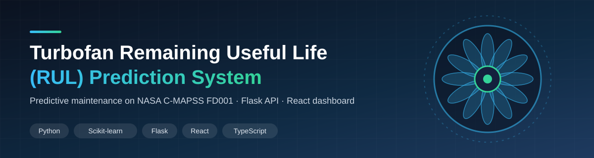
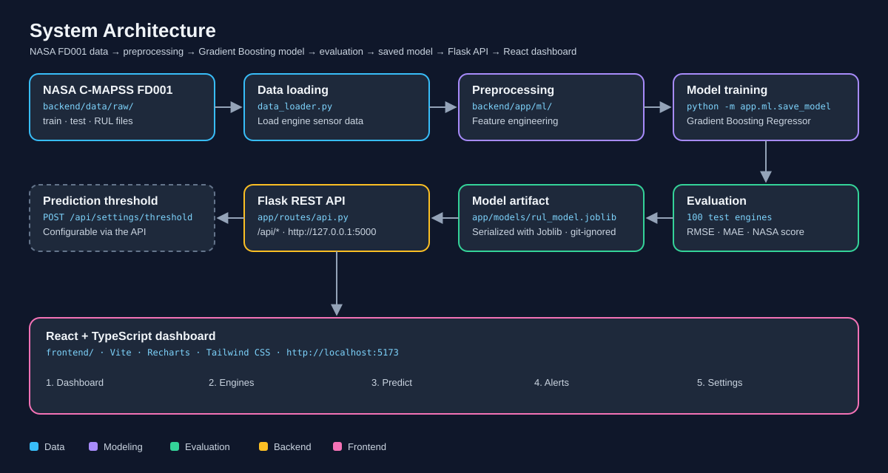
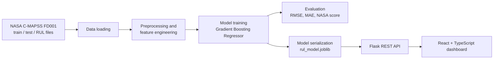

<p align="center">
  
</p>

# Turbofan Remaining Useful Life (RUL) Prediction System

An end-to-end machine learning and full-stack application that estimates the **Remaining Useful Life (RUL)** of aircraft turbofan engines from historical sensor measurements, using the NASA C-MAPSS FD001 dataset. A Gradient Boosting model is served through a Flask REST API and explored in a React + TypeScript dashboard.


> **Project type:** Machine Learning + Full-Stack Portfolio Project  
> **Domain:** Predictive maintenance / machine failure prediction  
> **Dataset:** NASA C-MAPSS Turbofan Engine Degradation Simulation, subset FD001  
> **Model:** Gradient Boosting Regressor (scikit-learn)

**Disclaimer:** This is an academic and portfolio predictive-maintenance application. It is not a production aviation safety or airworthiness system.

---

## System Flow

<p align="center">
  
</p>

---

## Model Performance

Evaluated on the 100 FD001 test engines using the true RUL values provided in `RUL_FD001.txt`.

| Metric | Result |
|---|---:|
| RMSE | 19.62 |
| MAE | 14.24 |
| NASA Score | 1287.42 |
| Engines evaluated | 100 |

> These figures come from the author's **local model execution**. They have not been independently reproduced, and results may differ across environments and library versions. For RMSE and MAE, lower is better; for the NASA score, lower is also better.

### What the metrics mean

- **MAE (Mean Absolute Error):** the average absolute difference between predicted and true RUL. It is expressed in engine cycles and is easy to interpret.
- **RMSE (Root Mean Squared Error):** the square root of the average squared error. It penalizes large errors more heavily than MAE, so a gap between RMSE and MAE indicates some larger misses.
- **NASA Score:** the asymmetric scoring function introduced with the PHM08 prognostics challenge. With `d = predicted RUL − true RUL`, the penalty is `exp(−d/13) − 1` for early predictions (`d < 0`) and `exp(d/10) − 1` for late predictions (`d ≥ 0`), summed over all engines. Late predictions are penalized more steeply because predicting a longer remaining life than the engine actually has is the more costly mistake in maintenance planning: the maintenance window may be missed. Early predictions are penalized more gently because they lead to unnecessary but safer maintenance.

---

## Project Overview

The system demonstrates how predictive maintenance can flag engines that may need maintenance before they fail. Starting from raw run-to-failure sensor data, it trains a regression model to estimate how many operating cycles an engine has left, exposes that model through a REST API, and presents engine-level predictions in a web dashboard.

## Key Features

- Machine learning model for RUL prediction (Gradient Boosting Regressor).
- Data loading, preprocessing and feature engineering for the NASA FD001 data.
- Model training, evaluation and serialization with Joblib.
- Evaluation with RMSE, MAE and the NASA scoring function.
- Flask REST API with health, summary, engine, history, prediction and threshold endpoints.
- React + TypeScript dashboard with Dashboard, Engines, Predict, Alerts and Settings pages.
- Configurable prediction threshold.

---

## Technology Stack

| Layer | Technologies |
|---|---|
| Machine learning / backend | Python, Flask, Flask-CORS, NumPy, Pandas, scikit-learn, Joblib |
| Frontend | React 19, TypeScript, Vite 8, Recharts, Tailwind CSS |

The complete dependency lists and versions are in `backend/requirements.txt` and `frontend/package.json`.

---

## Dataset

This project uses the **NASA C-MAPSS** (Commercial Modular Aero-Propulsion System Simulation) turbofan engine degradation dataset, subset **FD001**.

**Sources**

- NASA Prognostics Data Repository, Turbofan Engine Degradation Simulation Data Set: <https://c3.ndc.nasa.gov/dashlink/resources/139>
- NASA Intelligent Systems Division: <https://www.nasa.gov/intelligent-systems-division/>

**Citation:** A. Saxena and K. Goebel (2008). "Turbofan Engine Degradation Simulation Data Set", NASA Ames Prognostics Data Repository, NASA Ames Research Center, Moffett Field, CA.

### What FD001 represents

| Property | FD001 |
|---|---|
| Training engines | 100 (run to failure) |
| Test engines | 100 (series ends before failure) |
| Operating conditions | 1 (sea level) |
| Fault modes | 1 (HPC degradation) |

### Files

| File | Description | Shape in this project |
|---|---|---|
| `train_FD001.txt` | Full run-to-failure sensor series for each training engine | 20,631 rows × 26 columns |
| `test_FD001.txt` | Sensor series for each test engine, ending before failure | 13,096 rows × 26 columns |
| `RUL_FD001.txt` | True remaining useful life for each of the 100 test engines | 100 values |

### Data structure

Each row is one operating **cycle** (one flight) of one engine. The 26 columns are:

1. Engine (unit) number.
2. Time, in cycles.
3. Three operational settings.
4. Twenty-one sensor measurements (physical quantities such as temperatures, pressures and rotational speeds recorded at different points in the engine).

In the training set every engine runs until failure, so the remaining life at any cycle can be derived from how many cycles are left before that engine's last recorded cycle. In the test set each engine's series stops at some point before failure, and `RUL_FD001.txt` supplies the true remaining life after that last observed cycle. Exact column names, selected sensors and the way the RUL target is constructed are implemented in `data_loader.py`.

<!-- CONFIRM against data_loader.py: column names, dropped/constant sensors, RUL target construction (e.g. whether RUL is capped). -->

### Where to place the files

The raw NASA files are **not** stored in this repository. Download them and place all three inside:

```text
backend/data/raw/
├── train_FD001.txt
├── test_FD001.txt
└── RUL_FD001.txt
```

---

## Machine Learning Methodology

| Step | Detail |
|---|---|
| Model | `GradientBoostingRegressor` (scikit-learn) |
| Training data | NASA C-MAPSS FD001 training set |
| Evaluation data | FD001 test engines with true RUL from `RUL_FD001.txt` (100 engines) |
| Metrics | RMSE, MAE, NASA scoring function |
| Serialization | Joblib, saved to `backend/app/models/rul_model.joblib` |

Data loading, preprocessing and feature engineering code lives under `backend/app/ml/`, and the training entry point is `python -m app.ml.save_model`.

<!-- CONFIRM against backend/app/ml/: sensor selection, feature engineering, scaling, train/validation split, hyperparameters, feature importance output. Add them here as a table once verified. -->

This project does not claim cross-validation, hyperparameter tuning or comparison against other algorithms. Those are listed under [Future Improvements](#future-improvements).

### Workflow



---

## Backend Architecture

The backend is a Flask application (`backend/run.py` starts it) that:

1. Initializes the Flask app with CORS enabled so the Vite dev server can call it.
2. Registers the API routes defined in `backend/app/routes/api.py`.
3. Loads the serialized model from `backend/app/models/rul_model.joblib`.
4. Loads the engine data used for the dashboard and engine history views.
5. Generates RUL predictions and applies the configurable prediction threshold.

> The model file is generated locally and excluded from Git. **Train the model before starting the backend** if `rul_model.joblib` does not exist.

---

## API Documentation

Base URL: `http://127.0.0.1:5000`

| Method | Endpoint | Purpose |
|---|---|---|
| GET | `/api/health` | Backend health and model status |
| GET | `/api/summary` | Dashboard summary and model metrics |
| GET | `/api/engines` | Retrieve engine information |
| GET | `/api/engines/<int:engine_id>/history` | Retrieve the history of one engine |
| POST | `/api/predict` | Generate an RUL prediction |
| POST | `/api/settings/threshold` | Update the prediction threshold |

The exact request bodies, response fields and error responses for each route are defined in `backend/app/routes/api.py`.

<!-- CONFIRM against api.py: add request/response JSON examples and error responses for each endpoint. -->

### Testing the API

**Health check in the browser:** open <http://127.0.0.1:5000/api/health>.

**GET endpoints from PowerShell:**

```powershell
Invoke-RestMethod -Uri "http://127.0.0.1:5000/api/health"
Invoke-RestMethod -Uri "http://127.0.0.1:5000/api/summary"
Invoke-RestMethod -Uri "http://127.0.0.1:5000/api/engines"
```

**POST endpoints:** use Postman (or `Invoke-RestMethod -Method Post`) with the header `Content-Type: application/json` and a JSON body matching the fields expected by `/api/predict` and `/api/settings/threshold` in `backend/app/routes/api.py`.

---

## Frontend Architecture

The frontend is a React 19 + TypeScript application built with Vite, using Recharts for charts and Tailwind CSS for styling. It runs on `http://localhost:5173` in development and communicates with the Flask backend at `http://127.0.0.1:5000`.

| Page | Purpose |
|---|---|
| Dashboard | Overview of model results and fleet summary |
| Engines | Engine-level monitoring |
| Predict | RUL prediction interface |
| Alerts | Engines flagged against the prediction threshold |
| Settings | Application and threshold configuration |

<!-- CONFIRM against frontend/src: which API endpoints each page calls, API base URL configuration, exact content of each page. -->

---

## Project Folder Structure

Key paths only:

```text
turbofan-rul-prediction/
├── backend/
│   ├── app/
│   │   ├── ml/                    # data loading, preprocessing, training (save_model)
│   │   ├── models/
│   │   │   └── rul_model.joblib   # generated locally, excluded by .gitignore
│   │   └── routes/
│   │       └── api.py             # Flask API routes
│   ├── data/
│   │   └── raw/                   # NASA FD001 files go here (not committed)
│   ├── requirements.txt
│   └── run.py                     # starts the Flask backend
├── frontend/
│   └── package.json               # React, TypeScript, Vite, Recharts dependencies
├── .gitignore
└── tailwind.config.js
```

Excluded from the repository: `venv/`, `node_modules/`, the raw NASA dataset files, generated `.joblib` model files and cache files.

---

## Installation and Setup (Windows PowerShell)

**Prerequisites:** Python 3.13.4, Node.js 22.16.0, npm 10.9.2, Git.

### Backend

```powershell
# 1. Clone the repository
git clone https://github.com/yash-2999/turbofan-rul-prediction.git
cd turbofan-rul-prediction\backend

# 2. Create and activate a virtual environment
python -m venv venv
.\venv\Scripts\Activate.ps1

# 3. Install dependencies
pip install -r requirements.txt
```

4. Download the NASA FD001 files (see [Dataset](#dataset)) and place `train_FD001.txt`, `test_FD001.txt` and `RUL_FD001.txt` in `backend\data\raw\`.

```powershell
# 5. Train the model (creates app\models\rul_model.joblib)
python -m app.ml.save_model

# 6. Start the Flask backend
python run.py
```

The backend runs at `http://127.0.0.1:5000`. Verify it at `http://127.0.0.1:5000/api/health`.

### Frontend

Open a **second** terminal:

```powershell
cd turbofan-rul-prediction\frontend
npm install
npm run dev
```

The frontend runs at `http://localhost:5173`. Keep the backend running so the dashboard can fetch data.

---

## Testing

Backend tests are run from the `backend` folder with the virtual environment active:

```powershell
pip install pytest
python -m pytest
```

<!-- CONFIRM: test runner, test module locations, what each test verifies, and any limitations. Test coverage has not been measured. -->

Test coverage has not been measured, and no claim of complete coverage is made.

---

## Screenshots

Screenshots are not included yet. After running the app locally, capture the following pages and save them in `docs/screenshots/`:

| Page | Suggested file |
|---|---|
| Dashboard | `docs/screenshots/dashboard.png` |
| Engines | `docs/screenshots/engines.png` |
| Predict | `docs/screenshots/predict.png` |
| Alerts | `docs/screenshots/alerts.png` |
| Settings | `docs/screenshots/settings.png` |

No live demo is currently available.

---

## Limitations

- The data is **simulated** (NASA C-MAPSS) and only the FD001 subset is used: one operating condition and one fault mode.
- The reported metrics come from a single local run on 100 test engines and are not independently reproduced.
- The trained model file is not stored in the repository; it must be generated locally.
- Cross-validation, hyperparameter tuning and algorithm comparison are not part of the current implementation.
- The application runs with development servers only and is not packaged for deployment.
- Prediction uncertainty is not estimated.
- It is a portfolio project and must not be used for real maintenance or safety decisions.

## Future Improvements

These are planned ideas, not implemented features:

- Compare additional regression algorithms.
- Hyperparameter optimization.
- More comprehensive cross-validation.
- Prediction uncertainty estimation.
- Model monitoring.
- Support for FD002, FD003 and FD004.
- Additional automated tests.
- Docker-based deployment, CI/CD integration and cloud deployment.

---

## Author

**Yashraj Shinde**  
GitHub: [yash-2999](https://github.com/yash-2999)  
Repository: [turbofan-rul-prediction](https://github.com/yash-2999/turbofan-rul-prediction)
